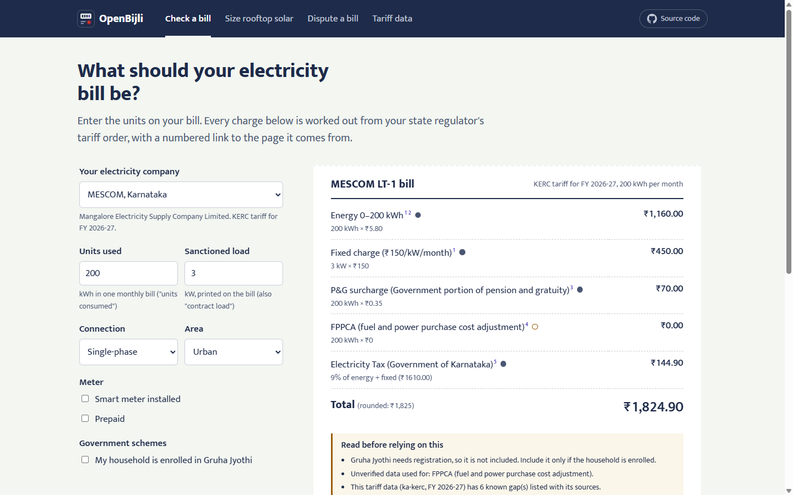
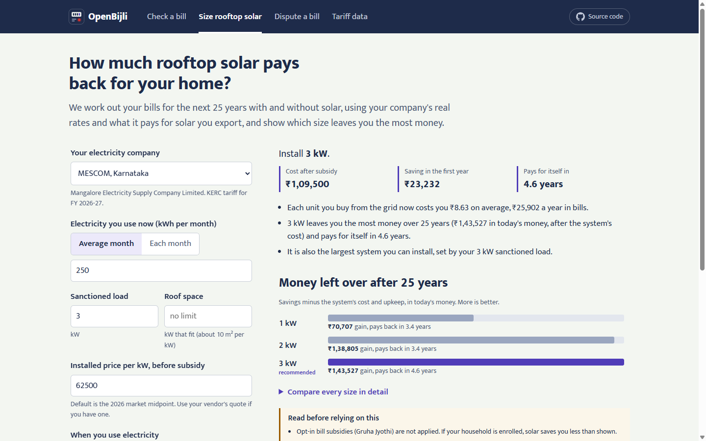
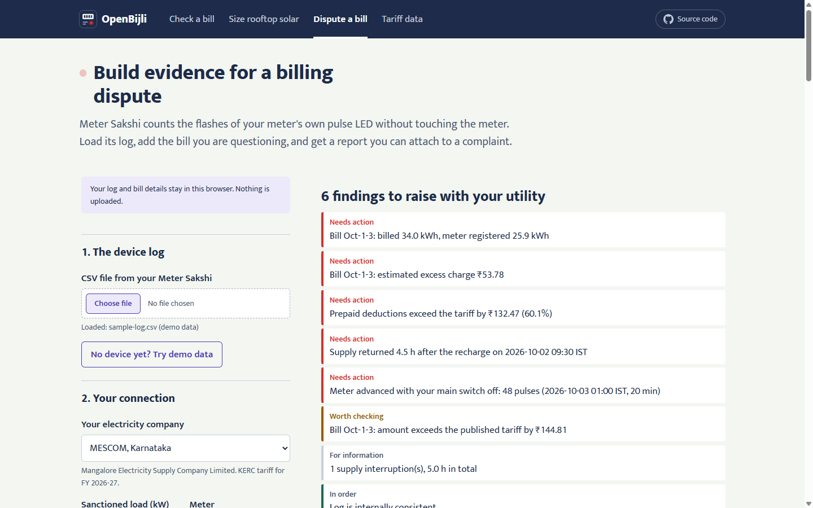
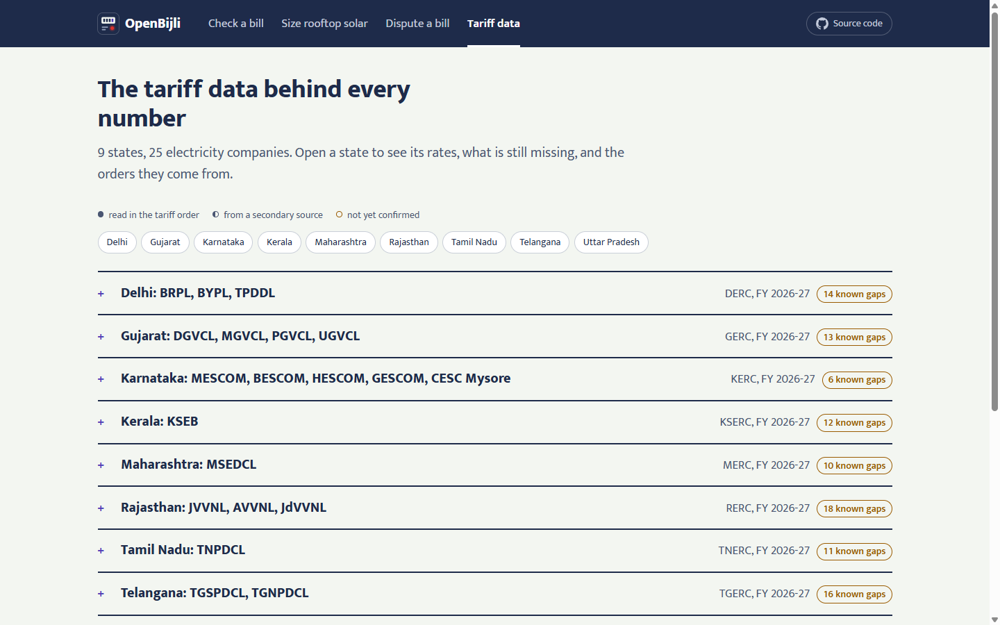

<div align="center">


# OpenBijli

**Every rupee on your electricity bill, traced to its source.**

Open Indian electricity tariff data, a bill engine, a rooftop solar payback simulator and
Meter Sakshi, a non-contact check meter for billing disputes.

[](https://github.com/byjoellobo/openbijli/actions/workflows/ci.yml)
[](https://github.com/byjoellobo/openbijli/releases)
[](https://byjoellobo.github.io/openbijli/)
[](https://nodejs.org/)
<br />
[](LICENSE)
[](data/LICENSE.md)
[](hardware/LICENSE.md)

[**Live demo**](https://byjoellobo.github.io/openbijli/) ·
[**Docs**](docs/README.md) ·
[**Releases**](https://github.com/byjoellobo/openbijli/releases) ·
[**Contributing**](CONTRIBUTING.md)

</div>

---

OpenBijli works out what an Indian household electricity bill should be, line by line, from
the state regulator's tariff order. Every slab rate, fixed charge, surcharge and subsidy in the
result links to the page of the order it came from, and every value that could not be
confirmed is flagged rather than guessed. The same engine bills 25 years of rooftop solar
cycles to find the system size that actually pays back, and turns a Meter Sakshi log into a
printable dispute report.

Everything runs locally: in your browser, or on your machine through the CLIs. Nothing you
enter is uploaded.

## Screenshots

<table>
  <tr>
    <td width="50%"><a href="docs/images/bill.png"></a><br /><sub><b>Check a bill.</b> An itemised slip; each line cites its tariff order.</sub></td>
    <td width="50%"><a href="docs/images/solar.png"></a><br /><sub><b>Size rooftop solar.</b> 25 years of real bills, with and without solar.</sub></td>
  </tr>
  <tr>
    <td width="50%"><a href="docs/images/dispute.png"></a><br /><sub><b>Dispute a bill.</b> Verify a Meter Sakshi log and build a report.</sub></td>
    <td width="50%"><a href="docs/images/data.png"></a><br /><sub><b>Tariff data.</b> Rates, known gaps and sources for every state.</sub></td>
  </tr>
</table>

The app is built for phones first: see the [mobile layout](docs/images/mobile.png).

## Features

- **Bill check.** Telescopic and whole-consumption slabs, fixed charges by load or
  consumption, time-of-day rates, fuel and power-purchase adjustments, electricity duty, meter
  rent, government free-unit schemes, and rooftop solar credits. Each line carries its
  citations and a verification mark.
- **Rooftop solar sizing.** Hour-by-hour generation from NASA POWER irradiance, every billing
  cycle for 25 years billed through the real tariff (net metering bank, settlement, export
  rates, network charges), PM Surya Ghar subsidy, NPV, IRR and payback for each size, and a
  plain-language reason for the recommendation.
- **Billing disputes with Meter Sakshi.** Verify a hash-chained pulse log, reconcile it against
  bills and prepaid deductions, measure supply restoration after recharges, evaluate home
  no-load and reference-load tests, and print a self-contained report.
- **Open tariff data.** One JSON "tariff book" per regulator and financial year, validated
  against a schema, with sources, page numbers, quotes, SHA-256 fingerprints and a list of
  known gaps.
- **Tariff season automation.** Pull requests that change data get an automatic comment with
  every changed field and the bill impact; a scheduled job opens an issue when new orders are
  due.
- **Local first.** A static web app and two CLIs. No accounts, no tracking, no server.

## Why

- Rooftop solar is going in at scale: about 506,000 households installed systems under PM
  Surya Ghar in July 2026 alone, toward a target of 10 million households by March 2027
  ([Mercom India](https://mercomindia.com/pm-surya-ghar-powers-5-million-homes-total-capacity-hits-15-gw)).
- Whether a system pays back depends on slab tariffs, export rates and banking rules.
  Lower-consumption households face longer paybacks because they sit in cheaper slabs or
  get free units: CSEP finds a 3 kWp system for a 1,500 kWh/yr household takes 11 years in
  Delhi and 20 in Karnataka with subsidised tariffs, against 5 and 9 without
  ([CSEP working paper](https://csep.org/working-paper/rooftop-solar-a-trade-off-between-consumer-benefit-and-discom-finances/)).
- The rules differ by utility and change every year. "Every DISCOM has its own application
  form, portal, fee structure"; one commercial net-metering list shows feed-in rates from
  ₹2.25 to ₹3.56/kWh across 21 DISCOMs in eight states and UTs, and names MESCOM only in a
  heading with no data ([Quickest](https://quickestimate.co/blog/net-metering-discom-list-india)).
- Free calculators often use one state-average tariff and leave out export credit; Desi
  Utility's Uttar Pradesh subsidy calculator, for example, uses ₹7.5/kWh for the whole state
  and excludes net-metering credit ([Desi Utility](https://desiutility.com/solar/subsidy-calculator/uttar-pradesh)).
- Smart prepaid meters are spreading faster than trust in them. 39 million smart meters were
  installed under RDSS by 31 December 2025, and Noida and Ghaziabad residents report bills
  jumping, low-balance alerts arriving late or never, and waits of 12 hours to seven days
  for supply after a recharge ([ThePrint](https://theprint.in/feature/noida-ghaziabad-residents-prepaid-electricity-meter-system/2900340/)).
  Uttar Pradesh's consumer council says the utility's check meters are not installed to
  standard ([The Daily Jagran](https://www.thedailyjagran.com/uttar-pradesh/up-customers-complain-of-unusual-surge-in-electricity-bills-after-smart-meter-installation-uppcl-responds-10258268)),
  and a formal test of a smart prepaid meter costs ₹175 under an MVVNL order, with check-meter
  applications requiring half of any dues to be paid first ([Amar Ujala](https://www.amarujala.com/lucknow/up-if-your-postpaid-smart-meter-is-running-fast-get-it-checked-for-just-rs-50-this-is-the-method-2025-09-03)).

## What is in this repository

| Part | Where | What it does |
|---|---|---|
| Tariff dataset | [`data/`](data/) | One JSON tariff book per regulator and financial year: slabs, fixed charges, ToD, surcharges, government subsidies, rooftop metering regimes, export rates, settlement and banking rules, consumer protections. Every block cites its source and says how sure we are. |
| [`@openbijli/data`](packages/data) | [`packages/data`](packages/data) | The validated catalog, the zod schema and lookup helpers. |
| [`@openbijli/engine`](packages/engine) | [`packages/engine`](packages/engine) | `computeBill()` for one billing cycle and `simulateSolar()` for right-sizing and payback. CLI: `openbijli`. |
| [`@openbijli/evidence`](packages/evidence) | [`packages/evidence`](packages/evidence) | Verifies Meter Sakshi logs, reconciles them against bills and prepaid deductions, runs home meter tests, renders a dispute report. CLI: `meter-sakshi`. |
| Web app | [`apps/web`](apps/web) | Bill check, solar sizing, dispute report and data browser, all in the browser. |
| Meter Sakshi | [`hardware/meter-sakshi`](hardware/meter-sakshi) | ESP32 firmware, ESPHome variant, 3D-printable sensor clip and box, wiring and safety notes. |
| Scripts | [`scripts/`](scripts/) | Data build and validation, tariff diffs, source fingerprinting, NASA POWER fetch, season check. |
| Automation | [`.github/`](.github/) | CI, Pages deploy, releases, firmware build, tariff PR review and the tariff season checklist. See [docs/ci-cd.md](docs/ci-cd.md). |

## Coverage (FY 2026-27)

9 tariff books covering 25 utilities:

| State | Utilities | Regulator |
|---|---|---|
| Karnataka | MESCOM, BESCOM, HESCOM, GESCOM, CESC Mysore | KERC |
| Maharashtra | MSEDCL | MERC |
| Gujarat | DGVCL, MGVCL, PGVCL, UGVCL | GERC |
| Delhi | BRPL, BYPL, TPDDL | DERC |
| Uttar Pradesh | PVVNL, MVVNL, DVVNL, PuVVNL, KESCO | UPERC |
| Tamil Nadu | TNPDCL | TNERC |
| Kerala | KSEB | KSERC |
| Telangana | TGSPDCL, TGNPDCL | TGERC |
| Rajasthan | JVVNL, AVVNL, JdVVNL | RERC |

Every book is marked `partial`: each lists the values that could not be confirmed (often the
month's fuel adjustment or the electricity duty base) in its `gaps`, and the engine warns
whenever such a value affects a bill. Open **Tariff data** in the app to read them.

## Quick start

Requires Node.js 22.12 or later.

```bash
git clone https://github.com/byjoellobo/openbijli.git
cd openbijli
npm install
npm test            # builds the catalog from data/, then runs every unit test
npm run dev         # web app on http://localhost:5173
```

Other useful commands:

| Command | What it does |
|---|---|
| `npm run typecheck` | Strict TypeScript check of every package and script |
| `npm run test:coverage` | Unit tests with coverage (80% lines and functions required) |
| `npm run test:e2e` | Playwright browser tests of the web app (first run: `npx playwright install chromium`) |
| `npm run build` | Builds the packages and the static web app |
| `npm run data:check` | Validates every tariff book and checks the committed JSON Schemas |

## Using the CLIs

From source (no build needed):

```bash
# Bills
npx tsx --conditions=source packages/engine/src/cli.ts utilities
npx tsx --conditions=source packages/engine/src/cli.ts bill --utility mescom --units 200 --load 3

# Rooftop solar sizing
npx tsx --conditions=source packages/engine/src/cli.ts solar --utility mescom --monthly 250 --load 3

# Meter Sakshi evidence
npx tsx --conditions=source packages/evidence/src/cli.ts verify hardware/meter-sakshi/samples/sample-log.csv
npx tsx --conditions=source packages/evidence/src/cli.ts report \
  --log hardware/meter-sakshi/samples/sample-log.csv \
  --case hardware/meter-sakshi/samples/sample-case.json --out report.html
```

After `npm run build` the same commands are available as `node packages/engine/dist/cli.js`
(`openbijli`) and `node packages/evidence/dist/cli.js` (`meter-sakshi`).

## Using as a library

```ts
import { getTariff, getSolarResourceForUtility, catalog } from '@openbijli/data';
import { computeBill, simulateSolar } from '@openbijli/engine';

const bill = computeBill(getTariff('mescom'), { units: 200, sanctionedLoadKw: 3 });
for (const line of bill.lines) console.log(line.label, line.amount, line.cite[0]?.url);

const plan = simulateSolar({
  book: getTariff('mescom'),
  resource: getSolarResourceForUtility('mescom'),
  monthlyConsumptionKwh: Array(12).fill(250),
  sanctionedLoadKw: 3,
  costPerKw: 62500,
  centralSubsidy: catalog.national.centralSubsidies[0],
});
console.log(plan.recommended?.sizeKw, plan.rationale);
```

Package docs: [`@openbijli/data`](packages/data/README.md),
[`@openbijli/engine`](packages/engine/README.md),
[`@openbijli/evidence`](packages/evidence/README.md).

## How it works

- **Bills** go through a fixed pipeline: solar netting, energy slabs (telescopic or
  whole-consumption), fixed charges, ToD, additional charges in file order, government
  subsidies, solar credits. Each line is rounded to paise and keeps its citations.
- **Solar** is simulated hour by hour on a representative day per month, using NASA POWER
  2001-2025 irradiance on a latitude-tilted plane for a city in each utility's area. Every
  billing cycle for 25 years is then billed through the real tariff, including the
  net-metering bank and its settlement, the lower export rates some states pay subsidised
  systems, and network charges on generation.
- **Meter Sakshi** counts the meter's own test-LED flashes, so it reads what the meter
  registered without touching it. Logs are hash-chained minute by minute; the same chain is
  implemented in the firmware (C++) and the evidence engine (TypeScript), and tests prove they
  produce identical hashes.

Details: [docs/methodology.md](docs/methodology.md) (the maths and its simplifications) and
[docs/architecture.md](docs/architecture.md) (how the pieces fit together).

## Principles

1. **Cite or omit.** A value without a source does not enter the dataset as fact.
2. **Say what is missing.** Gaps are data. Unconfirmed values are flagged in every output.
3. **New year, new file.** Tariff books are never edited in place for a new year, so old
   bills stay reproducible.
4. **The device never opens, wires into or alters the meter.** Meter Sakshi sits on the
   outside of the meter cover and reads light. See
   [hardware/meter-sakshi/docs/safety-and-legal.md](hardware/meter-sakshi/docs/safety-and-legal.md).
5. **Local first.** The web app and CLIs run on your machine; logs and bills are never uploaded.

## Status and limitations

OpenBijli is at **v0.1**. Treat results as a well-sourced estimate and always check a bill
against the current order before acting on it.

- The engine, simulator, evidence engine and firmware core are tested. The firmware compiles
  for ESP32 and its hash chain is verified against the TypeScript implementation, but it has
  not yet been run on a meter in the field.
- Bills use the sanctioned load; some states bill on recorded maximum demand.
- Solar uses an average day per month, which slightly overstates self-consumption.
- Household load profiles are illustrative unless you supply your own 24-hour profile (a
  Meter Sakshi log gives you one).
- The DLMS optical-port reading mode is not implemented: whether consumers may read that port
  is unverified, and the available WebAssembly DLMS library is GPL-2.0.

## Roadmap

- Close the listed `gaps` in each tariff book and fingerprint every primary source.
- FY 2027-28 tariff books as orders are published (April for most states, July for Tamil Nadu).
- More states and utilities, starting with the largest rooftop solar markets not yet covered.
- Billing on recorded maximum demand where the order requires it.
- Field trials of Meter Sakshi on single-phase smart and prepaid meters.
- Optional hourly or daily load profiles from a Meter Sakshi log in the solar simulator UI.

Ideas and priorities are discussed in [GitHub Discussions](https://github.com/byjoellobo/openbijli/discussions).

## Contributing

The lasting cost of this project is keeping tariffs current every April, so the most valuable
contribution is a tariff order encoded with page-level citations. Code, hardware and
documentation help is welcome too. Start with [CONTRIBUTING.md](CONTRIBUTING.md),
[docs/data-model.md](docs/data-model.md) and
[docs/tariff-update-workflow.md](docs/tariff-update-workflow.md).

Please follow the [Code of Conduct](CODE_OF_CONDUCT.md). For questions, see
[SUPPORT.md](SUPPORT.md).

## Security

Please report vulnerabilities privately through
[GitHub private vulnerability reporting](https://github.com/byjoellobo/openbijli/security/advisories/new),
not in public issues. See [SECURITY.md](SECURITY.md).

## Versioning and releases

OpenBijli follows [Semantic Versioning](https://semver.org/). All packages share one version
and each release is tagged `vX.Y.Z`. Release notes are generated from Conventional Commits;
see [CHANGELOG.md](CHANGELOG.md), [docs/releasing.md](docs/releasing.md) and the
[releases page](https://github.com/byjoellobo/openbijli/releases).

## Licence

| What | Licence |
|---|---|
| Code, including the web app and Meter Sakshi firmware | [MIT](LICENSE) |
| Tariff data (`data/tariffs`, `data/national`, `data/solar`) | [CC BY 4.0](data/LICENSE.md) |
| Meter Sakshi hardware designs (enclosure, wiring, assembly docs) | [CERN-OHL-P-2.0](hardware/LICENSE.md) |

Attribute the data as: "OpenBijli contributors, tariff data (CC BY 4.0)".

## Citation

If you use OpenBijli or its data in research or journalism, please cite it using
[CITATION.cff](CITATION.cff) (GitHub shows a "Cite this repository" button).

## Acknowledgements

- The state electricity regulatory commissions, utilities and governments whose tariff
  orders, regulations and gazettes are the primary source for every number here.
- The [NASA POWER Project](https://power.larc.nasa.gov/) for freely available solar
  irradiance data.
- Everyone who reports a wrong number or encodes a new order.
