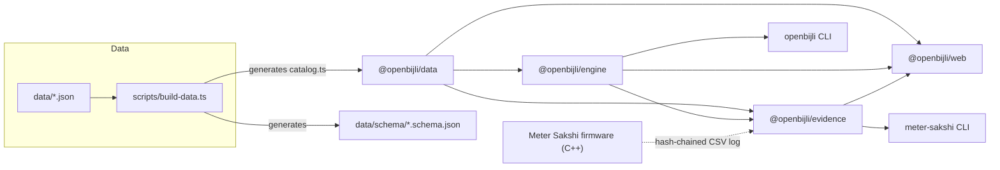
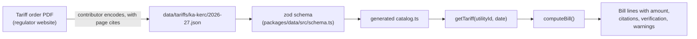

# Architecture

How OpenBijli is put together: where data lives, how it becomes a typed catalog, and how the
engines, CLIs, web app and Meter Sakshi firmware use it. For the maths behind bills, solar and
evidence, see [methodology.md](methodology.md). For the tariff file format, see
[data-model.md](data-model.md).

## Monorepo layout

An npm workspaces monorepo. TypeScript everywhere except the firmware (C++).

```
openbijli/
├── data/                       Source of truth: tariff books and national parameters (JSON, CC BY 4.0)
│   ├── tariffs/<bookId>/<FY>.json
│   ├── national/india.json
│   ├── solar/nasa-power.json
│   └── schema/*.schema.json    Generated JSON Schemas for editors
├── packages/
│   ├── data/                   @openbijli/data: schema (zod), generated catalog, lookups
│   ├── engine/                 @openbijli/engine: computeBill, simulateSolar, `openbijli` CLI
│   └── evidence/               @openbijli/evidence: log verification, analysis, reports, `meter-sakshi` CLI
├── apps/
│   └── web/                    @openbijli/web: React + Vite static app (GitHub Pages)
├── hardware/
│   └── meter-sakshi/           ESP32 firmware, ESPHome variant, OpenSCAD enclosure, docs, samples
├── scripts/                    Data build, validation, diff, fingerprinting, solar fetch, season check
├── docs/                       Methodology, data model, workflows, this file
└── .github/                    CI/CD workflows, issue forms, PR templates
```

## Package dependencies



| Package | Depends on | Runtime |
|---|---|---|
| `@openbijli/data` | `zod` (only in the `/schema` entry point) | Node 22+, browsers |
| `@openbijli/engine` | `@openbijli/data` | Node 22+, browsers |
| `@openbijli/evidence` | `@openbijli/data`, `@openbijli/engine`, `zod` | Node 22+, browsers (WebCrypto) |
| `@openbijli/web` | all three, React 19 | Browsers (static files) |

Each package's `exports` map includes a `source` condition pointing at its TypeScript sources.
Vitest, `tsx` and the Vite dev server resolve that condition, so tests, scripts and the web app
always run against current source without a separate package build. Published packages use
`dist/`.

## From tariff order to bill



1. **Encode.** Each tariff book covers one regulator and one financial year, and may serve
   several utilities. Every block carries `cite` references into the book's `sources`, a
   `verification` level (`verified`, `secondary`, `unverified`) and, where needed, `gaps`.
2. **Validate and generate.** `scripts/build-data.ts` (run by `npm test`, `npm run build`,
   `npm run dev`) reads everything under `data/` through `scripts/lib/data-files.ts`, validates it
   with the zod schemas, and writes:
   - `packages/data/src/generated/catalog.ts`, a typed constant of all books, national
     parameters and solar locations (git-ignored, always regenerated);
   - `data/schema/*.schema.json`, JSON Schemas for editor autocompletion (committed; CI fails if
     they are stale).
3. **Look up.** `getTariff(utilityId, onDate?)` returns the book in force for that utility on
   that date, so an old bill is always priced with the order that applied to it.
4. **Compute.** `computeBill()` runs a fixed pipeline and returns line items, each rounded to
   paise, with resolved citations and the verification level of the block it came from.

### The bill pipeline

| Stage | Module | What happens |
|---|---|---|
| 1. Solar netting | `bill/solar.ts` | Net metering, net billing or gross metering; banking and settlement of surplus units |
| 2. Energy | `bill/energy.ts` | Pick the first matching schedule; price telescopic or whole-consumption slabs |
| 3. Fixed | `bill/fixed.ts` | Pick the first matching rule; bands by load or consumption; load rounding |
| 4. Time of day | `bill/tod.ts` | Peak and off-peak adjustments when the consumer qualifies and a split is given |
| 5. Additional charges | `bill/charges.ts` | Fuel and purchase adjustments, duty, surcharges, meter rent, solar network charges, in file order |
| 6. Subsidies | `bill/subsidy.ts` | Automatic and opt-in government schemes (payable schedule or entitlement) |
| 7. Solar credits | `bill/compute.ts` | Export payments as negative lines |

`bill/context.ts` evaluates conditions (phase, area, load, flags such as `smart_meter` or
`prepaid`) and resolves citations; `money.ts` handles paise rounding.

## Solar simulation

`simulateSolar()` (`packages/engine/src/solar/`) reuses the bill engine rather than estimating
savings with an average rate:

1. `geometry.ts` turns monthly NASA POWER irradiance into an hourly generation shape for the
   site, correcting clock time for longitude and the equation of time.
2. `profiles.ts` spreads monthly consumption over the day (evening peak, daytime at home, flat,
   or a custom 24-hour profile).
3. `balance.ts` matches generation and load hour by hour on a representative day per month to
   get self-consumption, imports and exports.
4. `simulate.ts` bills every cycle of every year with and without solar through
   `computeBill()`, carrying the net-metering bank between cycles.
5. `finance.ts` applies installed cost, PM Surya Ghar assistance, maintenance and inverter
   replacement, then computes NPV, IRR and payback. The feasible size with the highest NPV is
   recommended, with a rationale.

## Meter Sakshi evidence chain

The firmware and the evidence engine implement the same log format and hash chain
([log-format.md](../hardware/meter-sakshi/docs/log-format.md)), so a log exported from the device
can be verified anywhere.

```mermaid
sequenceDiagram
  participant LED as Meter kWh LED
  participant FW as ESP32 firmware (C++)
  participant FS as LittleFS (8-byte records)
  participant USER as Household
  participant EV as @openbijli/evidence (TS)
  LED->>FW: light pulses (1 per 1/k kWh)
  FW->>FW: pulse_filter.h rejects noise; count per minute
  FW->>FS: minute record (epoch minute, pulses, flags)
  USER->>FW: export with PIN (/api/log)
  FW->>USER: CSV with SHA-256 chain and daily digests
  USER->>EV: log.csv + case.json (bills, ledger, tests)
  EV->>EV: parseLog (strict) and verifyChain
  EV->>EV: reconcile bills, audit prepaid, outages, meter tests
  EV->>USER: HTML or Markdown dispute report
```

- **Chain.** `genesis = SHA-256("meter-sakshi|v1|" + device_id + "|" + imp_per_kwh)` and
  `hash_i = SHA-256(hash_{i-1} + "|" + minute + "|" + pulses + "|" + flags)`. The C++ side lives
  in `firmware/lib/sakshi_core/` (`sha256.cpp`, `record.cpp`); the TypeScript side in
  `packages/evidence/src/log/` (`hash.ts`, `verify.ts`). Both are tested against the same
  vectors.
- **Verification** recomputes hashes in parallel batches. Because each expected hash depends
  only on the stored hash before it, a single edited record is located exactly.
- **Wiring.** `packages/evidence/src/wiring.ts` connects the analysis code to the bundled
  catalog and bill engine, so the analysis stays pure and testable with any tariff source.

## Web app

`apps/web` is a React 19 single-page app built with Vite. It uses hash routes (`#/bill`,
`#/solar`, `#/sakshi`, `#/data`) so it works from any static host, including GitHub Pages
under a sub-path (`BASE_PATH`). The engines run in the browser; the Meter Sakshi sample log
and case file are bundled for the demo.

## Security model

- **Local first.** The web app and CLIs make no network requests with user data. Logs, bills
  and case files are read with the File API and processed in memory. There are no accounts,
  analytics or cookies.
- **Content-Security-Policy.** The built `index.html` carries a CSP meta tag (`default-src
  'self'`, no inline scripts, `object-src 'none'`, `base-uri 'none'`, `form-action 'none'`).
  Generated dispute reports carry their own stricter CSP (`default-src 'none'`) and escape
  every value.
- **Untrusted input.** Tariff books, case files and logs are validated with zod or strict
  parsers before use. Only `http(s)` URLs become links.
- **Firmware.** PIN-protected device API (salted hash, lockout), Host header checks against DNS
  rebinding, cross-site POST rejection and frame blocking. See
  [hardware/meter-sakshi/README.md](../hardware/meter-sakshi/README.md#device-security).
- **CI.** Untrusted pull requests run with read-only tokens; the tariff review comment is
  posted by a separate privileged workflow that never runs pull request code. See
  [ci-cd.md](ci-cd.md).

## Build and release outputs

| Output | Built by | Published to |
|---|---|---|
| Static web app (`apps/web/dist`) | `npm run build` | GitHub Pages, and attached to each GitHub Release |
| npm packages (`packages/*/dist`) | `npm run build` | GitHub Releases; npm when publishing is enabled |
| Firmware (`.pio/build/esp32dev`) | `pio run -e esp32dev` | Built in CI on firmware changes |

Release mechanics: [releasing.md](releasing.md). Workflows: [ci-cd.md](ci-cd.md).
